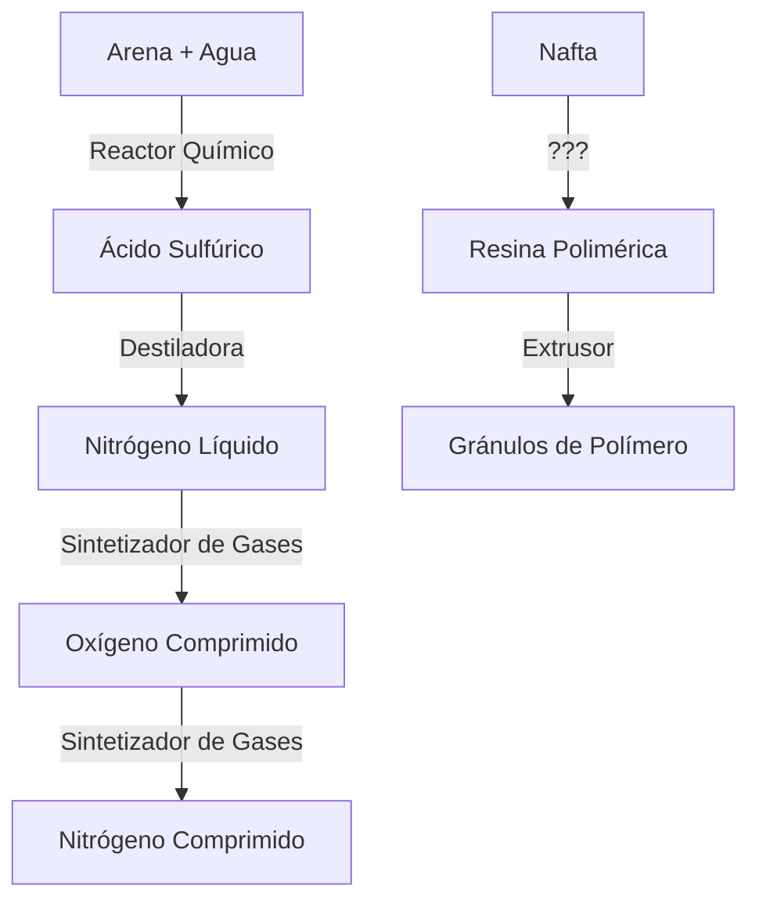
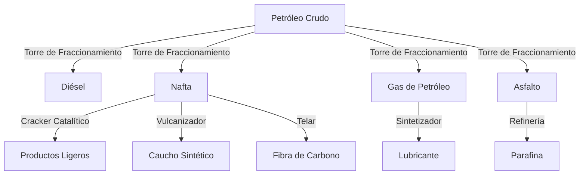
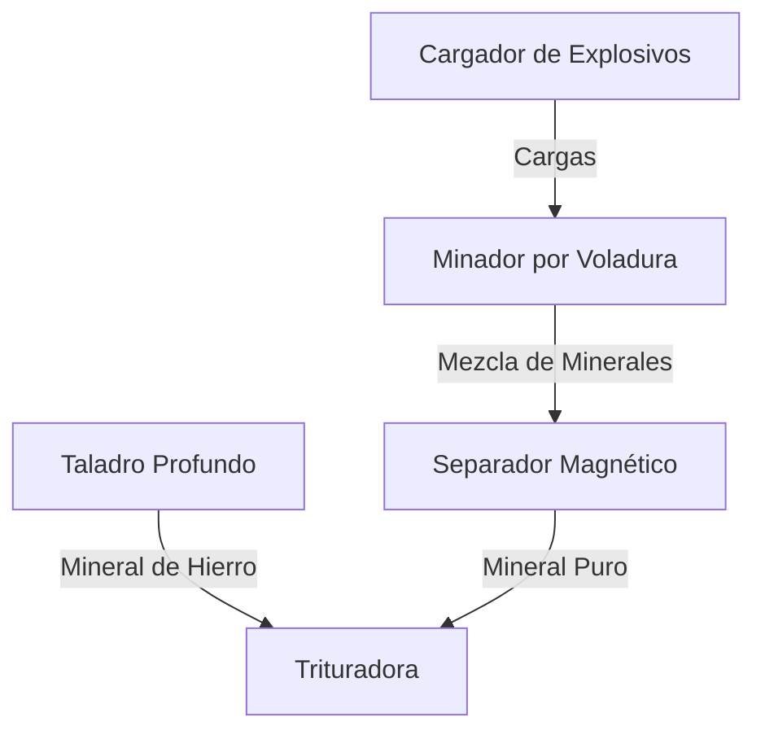
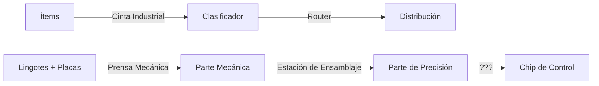

# 🏭 Industry Mod — Árbol de Tecnología y Cadenas de Producción

> Guía visual de todas las cadenas de producción del mod Industry

---

## 📊 Índice de Cadenas

1. [Metalurgia](#1-metalurgia)
2. [Química Básica & Gases](#2-química-básica--gases)
3. [Petroquímica & Refinería](#3-petroquímica--refinería)
4. [Minería & Extracción](#4-minería--extracción)
5. [Automatización & Manufactura](#5-automatización--manufactura)
6. [Control Industrial](#6-control-industrial)

---

## 1. Metalurgia

### Cadena Completa: Mineral → Aleación


### Detalle de Procesos

#### 🔹 Trituradora Industrial (`ore-grinder`)
```
INPUT:  Cobre x3 (vanilla)
OUTPUT: Polvo de Cobre x2
POWER:  0.8 kW
TIME:   90 ticks (1.5s)
SIZE:   2x2
```

**Recetas**:
- Cobre → Polvo de Cobre
- Plomo → Polvo de Plomo *(futuro)*
- Mineral de Hierro → Polvo de Hierro

---

#### 🔹 Horno de Arco (`arc-furnace`)
```
INPUT:  Polvo de Hierro x4
OUTPUT: Metal Fundido x4 L/s
POWER:  2.5 kW
TIME:   120 ticks (2s)
SIZE:   2x2
```

**Descripción**: Funde polvo metálico usando arco eléctrico de alta tensión.

---

#### 🔹 Lingotería (`casting-mold`)
```
INPUT:  Metal Fundido x6 L/s
OUTPUT: Lingote de Acero x1
POWER:  0 kW (enfriamiento pasivo)
TIME:   150 ticks (2.5s)
SIZE:   2x2
```

**Descripción**: Vierte metal fundido en moldes de enfriamiento rápido.

---

#### 🔹 Laminador (`rolling-mill`)
```
INPUT:  Lingote de Acero x3
OUTPUT: Plancha de Acero x2
POWER:  3.0 kW
TIME:   200 ticks (3.3s)
SIZE:   3x3
```

**Descripción**: Lamina lingotes en planchas industriales bajo presión hidráulica.

---

#### 🔹 Forja de Aleaciones (`alloy-forge`)
```
INPUT:  Plancha de Acero x2 + Titanio x1 (vanilla)
OUTPUT: Varilla de Aleación x1
POWER:  4.0 kW
TIME:   300 ticks (5s)
SIZE:   3x3
```

**Descripción**: Combina metales a 1800°C para crear aleaciones de alta resistencia.

---

## 2. Química Básica & Gases

### Cadena: Arena + Agua → Gases Industriales



### Detalle de Procesos

#### 🔹 Reactor Químico (`chemical-reactor`)
```
INPUT:  Arena x2 + Agua x3 L/s
OUTPUT: Ácido Sulfúrico x2 L/s
POWER:  2.0 kW
TIME:   180 ticks (3s)
SIZE:   3x3
```

**Reacción**: `SiO₂ + H₂O + catalizador → H₂SO₄`

---

#### 🔹 Destiladora Industrial (`distillation`)
```
INPUT:  Ácido Sulfúrico x2 L/s
OUTPUT: Nitrógeno Líquido x3 L/s
POWER:  3.0 kW
TIME:   240 ticks (4s)
SIZE:   3x3
```

**Descripción**: Separación por punto de ebullición. Produce fluido criogénico (-196°C).

---

#### 🔹 Sintetizador de Gases (`gas-synthesizer`)
```
INPUT:  Nitrógeno Comprimido x1 + Agua x5 L/s
OUTPUT: Oxígeno Comprimido x1
POWER:  4.5 kW
TIME:   280 ticks (4.7s)
SIZE:   3x3
```

**Descripción**: Electrólisis de agua + compresión de gases en cápsulas industriales.

---

#### 🔹 Extrusor de Polímeros (`polymer-extruder`)
```
INPUT:  Resina Polimérica x4 L/s
OUTPUT: Gránulos de Polímero x2
POWER:  1.5 kW
TIME:   160 ticks (2.7s)
SIZE:   2x2
```

**Descripción**: Solidifica polímeros líquidos en gránulos por extrusión térmica.

---

## 3. Petroquímica & Refinería

### Cadena Completa: Crudo → Productos Refinados



### Detalle de Procesos

#### 🔹 Torre Extractora de Petróleo (`oil-derrick`)
```
INPUT:  -
OUTPUT: Petróleo Crudo x6 L/s
POWER:  3.0 kW
BOOST:  Agua → +50% velocidad
TIME:   300 ticks (5s)
SIZE:   4x4
```

**Descripción**: Extrae crudo del subsuelo con perforación profunda. Acepta líquido boost.

---

#### 🔹 Torre de Fraccionamiento (`fractional-tower`)
```
INPUT:  Petróleo Crudo x10 L/s
OUTPUT: Diésel x3 L/s (fracción pesada)
        Nafta x2 L/s (fracción ligera)
        Gas de Petróleo x1 L/s (fracción volátil)
        Asfalto x1 sólido (residuo)
POWER:  5.0 kW
TIME:   400 ticks (6.7s)
SIZE:   4x4
```

**Descripción**: Destilación fraccionada multi-etapa. Produce 4 outputs simultáneos.

---

#### 🔹 Cracker Catalítico (`catalytic-cracker`)
```
INPUT:  Nafta x5 L/s + Catalizador x1 (opcional)
OUTPUT: Gas de Petróleo x4 L/s + Parafina x1
POWER:  4.0 kW
TIME:   350 ticks (5.8s)
SIZE:   4x4
```

**Descripción**: Rompe cadenas largas de hidrocarburos en moléculas ligeras.

---

#### 🔹 Sintetizador de Lubricantes (`lubricant-synthesizer`)
```
INPUT:  Gas de Petróleo x4 L/s + Plastanium x1 (vanilla)
OUTPUT: Lubricante x3 L/s
POWER:  2.5 kW
TIME:   220 ticks (3.7s)
SIZE:   3x3
```

**Descripción**: Produce lubricante sintético de alta viscosidad. Acelera maquinaria.

---

#### 🔹 Vulcanizador (`vulcanizer`)
```
INPUT:  Nafta x6 L/s + Azufre x2 (vanilla)
OUTPUT: Caucho Sintético x2
POWER:  3.0 kW
TIME:   300 ticks (5s)
SIZE:   3x3
```

**Descripción**: Vulcanización térmica. Produce caucho elástico para juntas y sellos.

---

#### 🔹 Telar de Fibra de Carbono (`carbon-fiber-loom`)
```
INPUT:  Nafta x8 L/s + Grafito x3 (vanilla)
OUTPUT: Fibra de Carbono x1
POWER:  4.5 kW
TIME:   400 ticks (6.7s)
SIZE:   3x3
```

**Descripción**: Teje hebras de carbono de ultra-alta resistencia y bajo peso.

---

## 4. Minería & Extracción

### Cadena: Extracción Masiva de Mineral



### Detalle de Procesos

#### 🔹 Taladro Profundo (`deep-drill`)
```
INPUT:  -
OUTPUT: Mineral de Hierro x1 (cada ciclo)
POWER:  2.0 kW
BOOST:  Lubricante → +60% velocidad
TIME:   300 ticks (5s)
SIZE:   3x3
```

**Descripción**: Extrae mineral de hierro de vetas profundas. Requiere suelo específico.

---

#### 🔹 Cargador de Explosivos (`explosive-charger`)
```
INPUT:  Blast Compound x2 (vanilla) + Pyratite x1 (vanilla)
OUTPUT: Carga Explosiva x1
POWER:  1.5 kW
TIME:   180 ticks (3s)
SIZE:   2x2
```

**Propiedades**: Alta flamabilidad (1.2) y explosividad (1.5).

---

#### 🔹 Minador por Voladura (`blast-miner`)
```
INPUT:  Carga Explosiva x1
OUTPUT: Mezcla de Minerales x15 L/s (slurry)
POWER:  3.5 kW
TIME:   240 ticks (4s)
SIZE:   4x4
```

**Descripción**: Extracción masiva por voladura controlada. Output líquido de minerales.

---

#### 🔹 Separador Magnético (`magnetic-separator`)
```
INPUT:  Mezcla de Minerales x10 L/s
OUTPUT: Cobre x2 + Plomo x1 + Hierro x1 (probabilidades)
POWER:  3.0 kW
TIME:   200 ticks (3.3s)
SIZE:   3x3
```

**Descripción**: Separación magnética de mezclas minerales en componentes puros.

---

## 5. Automatización & Manufactura

### Cadena: Transporte → Manufactura Avanzada



### Detalle de Bloques

#### 🔹 Cinta Transportadora Industrial (`industrial-conveyor`)
```
SPEED:    14 ítems/s (más rápida que conveyor vanilla)
SIZE:     1x1
CATEGORY: Distribution
```

---

#### 🔹 Clasificador de Ítems (`item-sorter`)
```
FUNCTION: Separa ítems por tipo (similar a Sorter vanilla)
SIZE:     1x1
CATEGORY: Distribution
```

---

#### 🔹 Router de Distribución (`distribution-router`)
```
FUNCTION: Distribuye ítems a 4 direcciones (mejorado)
CAPACITY: 12 ítems
SIZE:     1x1
CATEGORY: Distribution
```

---

#### 🔹 Prensa Mecánica (`mechanical-press`)
```
INPUT:  Plancha de Acero x2 + Silicio x1 (vanilla)
OUTPUT: Parte Mecánica x1
POWER:  2.5 kW
TIME:   250 ticks (4.2s)
SIZE:   3x3
```

**Descripción**: Estampa piezas mecánicas de precisión bajo presión hidráulica.

---

#### 🔹 Estación de Ensamblaje (`assembly-station`)
```
INPUT:  Parte Mecánica x2 + Grafito x2 (vanilla)
OUTPUT: Parte de Precisión x1
POWER:  3.5 kW
TIME:   350 ticks (5.8s)
SIZE:   3x3
```

**Descripción**: Ensamblaje de componentes de ultra-precisión para robótica.

---

## 6. Control Industrial

### Bloques de Monitoreo

#### 🔹 PLC Industrial (`industrial-plc`)
```
FUNCTION: Programmable Logic Controller
MEMORY:   256 cells (más que Logic Processor vanilla)
SIZE:     2x2
CATEGORY: Logic
```

**Descripción**: Autómata programable para control de procesos industriales.

---

#### 🔹 Sensor de Flujo (`flow-sensor`)
```
FUNCTION: Mide caudal de líquidos en tuberías
OUTPUT:   Señal proporcional al flow rate
SIZE:     1x1
CATEGORY: Logic
```

**Descripción**: Sensor digital para monitoreo de procesos químicos.

---

#### 🔹 Panel de Producción (`production-dashboard`)
```
FUNCTION: Dashboard visual de métricas (UI futuro)
DISPLAY:  Stats de producción de área
SIZE:     3x3
CATEGORY: Logic
```

**Descripción**: Terminal de visualización para optimización de fábricas.

---

## 📈 Tabla de Costos y Requisitos

### Metalurgia

| Bloque | Tamaño | Costo | Energía | Tiempo |
|--------|--------|-------|---------|--------|
| Trituradora | 2x2 | Cu×75 Pb×50 Gr×30 | 0.8 kW | 90t |
| Horno de Arco | 2x2 | Cu×100 Pb×80 Si×45 | 2.5 kW | 120t |
| Lingotería | 2x2 | Cu×90 Ti×40 Si×35 | 0 kW | 150t |
| Laminador | 3x3 | Ti×120 Si×80 Gr×70 | 3.0 kW | 200t |
| Forja | 3x3 | Ti×150 Si×100 Pl×50 | 4.0 kW | 300t |

### Química

| Bloque | Tamaño | Costo | Energía | Tiempo |
|--------|--------|-------|---------|--------|
| Reactor Químico | 3x3 | Pb×110 Si×70 Ti×60 | 2.0 kW | 180t |
| Destiladora | 3x3 | Mg×80 Ti×90 Si×60 | 3.0 kW | 240t |
| Extrusor | 2x2 | Pb×90 Ti×50 Si×40 | 1.5 kW | 160t |
| Sintetizador | 3x3 | Ti×130 Si×90 Pl×45 | 4.5 kW | 280t |

### Petroquímica

| Bloque | Tamaño | Costo | Energía | Tiempo |
|--------|--------|-------|---------|--------|
| Torre Extractora | 4x4 | Ti×200 Si×150 Th×100 | 3.0 kW | 300t |
| Torre Fraccionamiento | 4x4 | Ti×250 Si×180 Pl×120 | 5.0 kW | 400t |
| Cracker Catalítico | 4x4 | Ti×220 Si×160 Th×90 | 4.0 kW | 350t |
| Sintetizador Lub. | 3x3 | Ti×140 Si×100 Pl×60 | 2.5 kW | 220t |
| Vulcanizador | 3x3 | Pb×130 Ti×90 Si×70 | 3.0 kW | 300t |
| Telar C.Fiber | 3x3 | Ti×180 Si×120 Pl×80 | 4.5 kW | 400t |

---

## 🎯 Guías de Progresión Recomendadas

### Early Game (Fase 1)

1. **Trituradora Industrial** → Procesa cobre y plomo vanilla
2. **Reactor Químico** → Ácido sulfúrico básico
3. **Cinta Industrial** → Mejora logística temprana

### Mid Game (Fase 2)

4. **Horno de Arco + Lingotería** → Cadena metalúrgica completa
5. **Taladro Profundo** → Mineral de hierro exclusivo
6. **Torre Extractora** → Acceso a petroquímica

### Late Game (Fase 3)

7. **Torre de Fraccionamiento** → Refinería completa
8. **Forja de Aleaciones** → Materiales avanzados
9. **Telar de Fibra de Carbono** → Material end-game

### End Game (Fase 4)

10. **Estación de Ensamblaje** → Robótica avanzada
11. **PLC Industrial** → Automatización total
12. **Dashboard de Producción** → Optimización máxima

---

## 💎 Ítems de Mayor Valor

| Ítem | Cost Factor | Cadena Requerida |
|------|-------------|------------------|
| **Fibra de Carbono** | 9.0 | Petroquímica completa |
| **Chip de Control** | 12.0 | Robótica + Electrónica |
| **Parte de Precisión** | 10.0 | Manufactura avanzada |
| **Varilla de Aleación** | 8.0 | Metalurgia completa |
| **Carga Explosiva** | 6.0 | Pirotecnia + Química |

---

## 🏆 Achievements Sugeridos (Futuro)

- [ ] **Industrialista** — Construye todos los bloques de metalurgia
- [ ] **Químico Loco** — Produce 10,000 L de ácido sulfúrico
- [ ] **Barón del Petróleo** — Extrae 50,000 L de crudo
- [ ] **Ingeniero Maestro** — Fabrica 100 chips de control
- [ ] **Automatización Total** — Conecta 10 PLCs en red

---

**Última actualización**: 2026-11-04  
**Versión del mod**: 1.0.0
